# Studio

在 Redmine 上的现代工作台。日常操作走 `/app` 里的 React 界面，数据仍由 Rails 和 SQLite 保存。

## 启动

```powershell
Set-Location F:\misc\redmine
$env:RAILS_ENV='production'
bundle exec rails server -b 127.0.0.1 -p 3000
```

浏览器打开 [http://127.0.0.1:3000/app/](http://127.0.0.1:3000/app/)。

前端改完后在 `frontend` 目录执行 `npm run build`，产物写入 `public/app`。只改了 Ruby 代码时需要重启服务。

## 使用流程

登录后从左侧进入各功能。管理类入口在「管理」分组里，需要管理员账号。

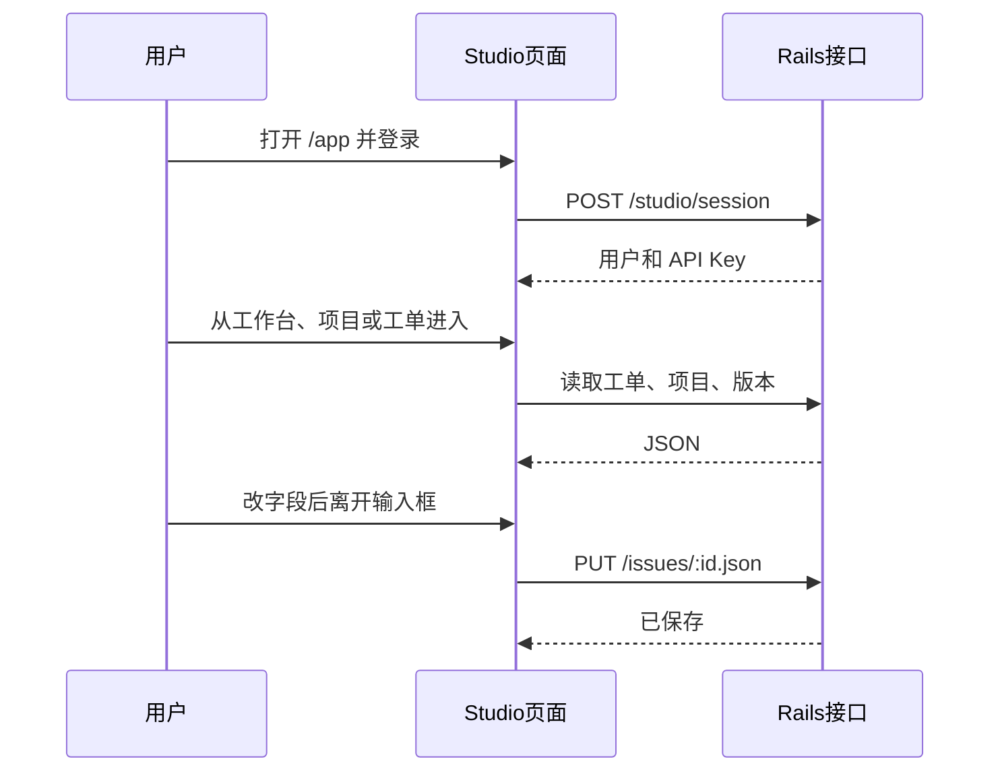

1. 工作台按「指派给我 / 我创建的 / 我关注的 / 全部」、状态和项目筛工单，超过 15 条可以翻页。
2. 项目页可以新建项目，进入项目后再看工单、版本、Wiki 等。
3. 工单列表可以改列、复制编号和主题。点进详情后，右侧字段改完即保存；描述双击进入编辑，支持 Markdown 和粘贴图片。
4. 甘特图按项目和版本分组。Ctrl + 滚轮缩放时间，在时间轴上按住拖动可以左右移动。
5. 日历按开始日期到完成日期铺工单。格子放不下时显示「还有 N 条」或「共 N 条」，点开看完整列表。
6. PM 选择项目和版本后，看纳入量、查完量、完成量、缺陷和健康结论。

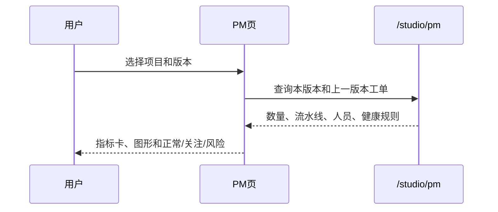

## 功能

### 工作台

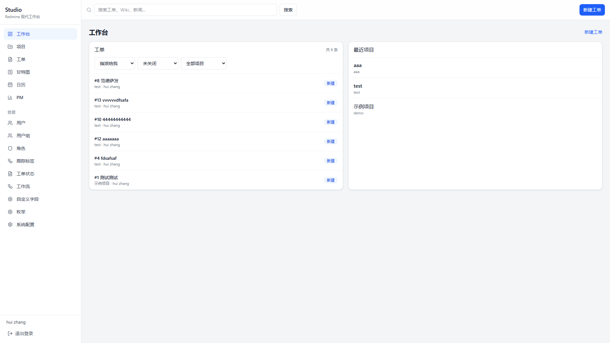

### 项目

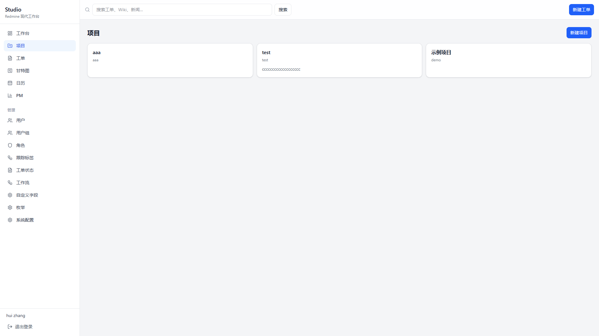

### 工单

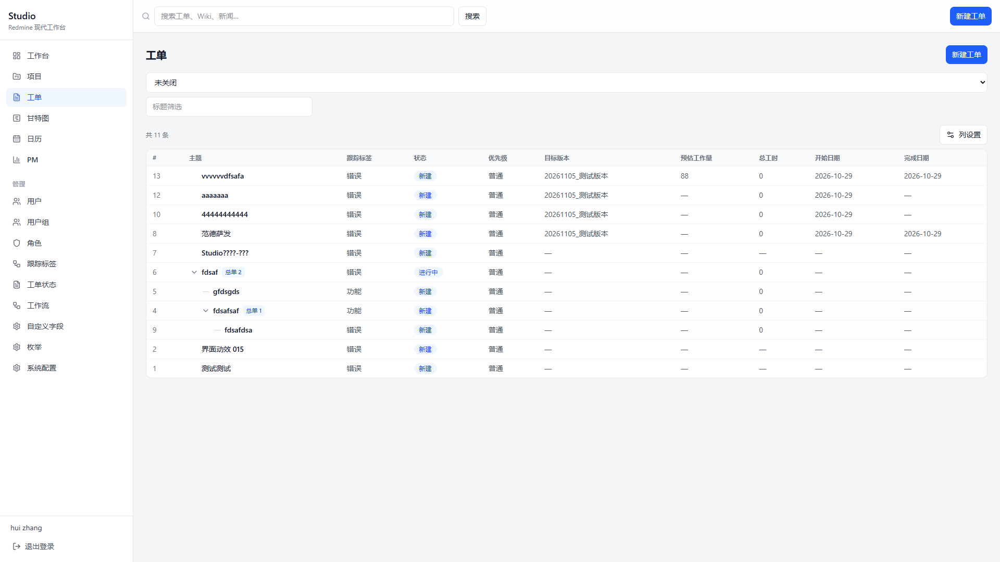

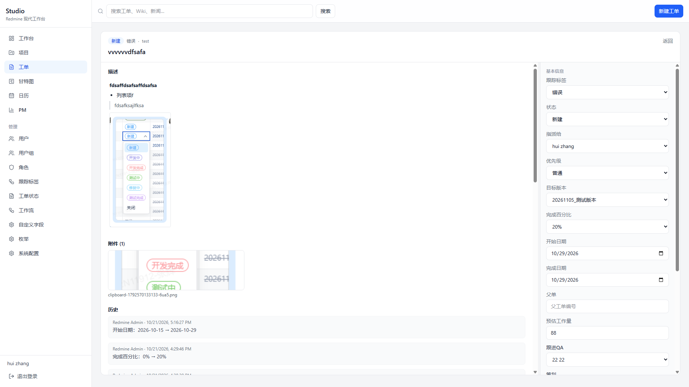

详情里可以改状态、指派、版本、日期和自定义字段。附件图片可以全屏看。关注者在右侧添加或移除。备注只保存文字。

### 甘特图

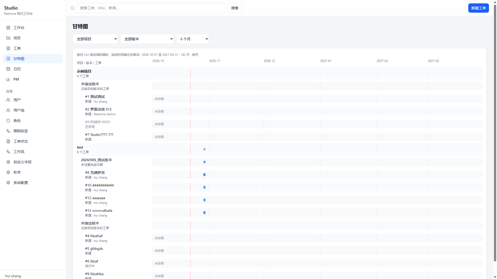

### 日历

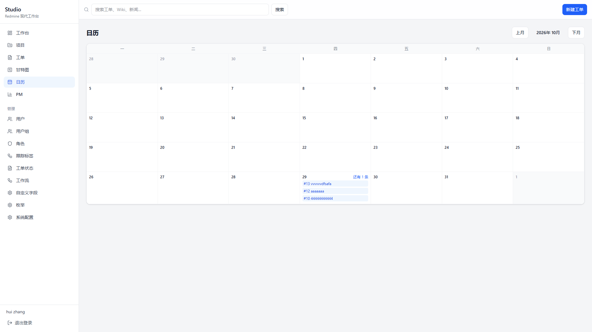

### PM

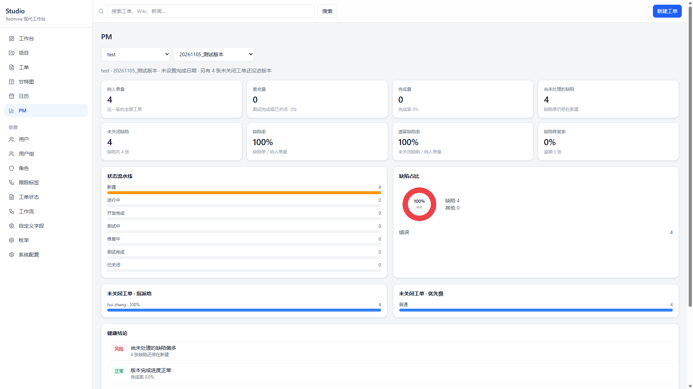

缺陷单是跟踪标签名称里带「错误」或「BUG」的工单。查完量指状态为「测试完成」或「已关闭」。尚未处理的缺陷指还停在「新建」的缺陷单。纳入不足 5 张时，比率类结论标成「样本不足」。

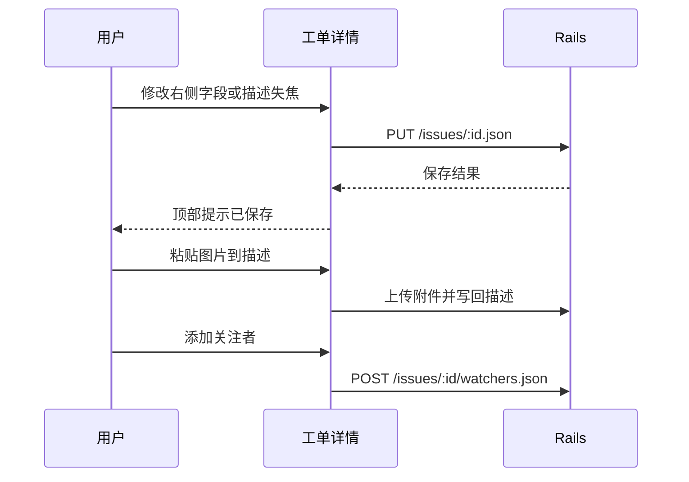

## 管理

管理员可以维护用户、用户组、角色、跟踪标签、工单状态、工作流、自定义字段、枚举和系统配置。

自定义字段决定工单上多出来的输入项，例如用户组里的成员。枚举负责优先级、文档分类、时间活动，也可以新建一整类枚举字段，再维护它的选项。

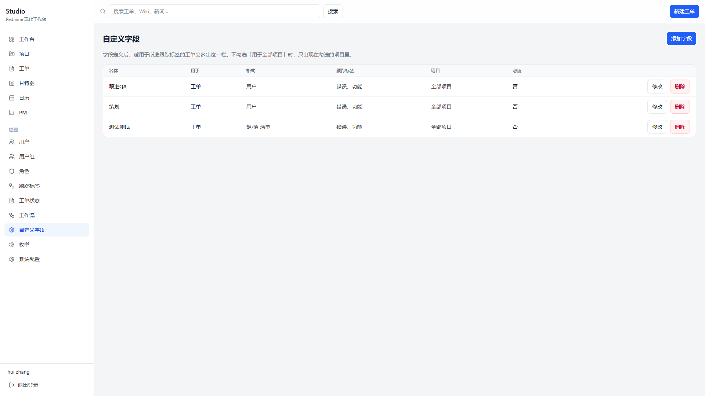

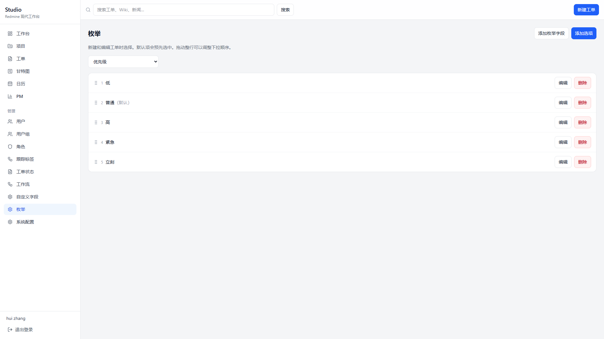

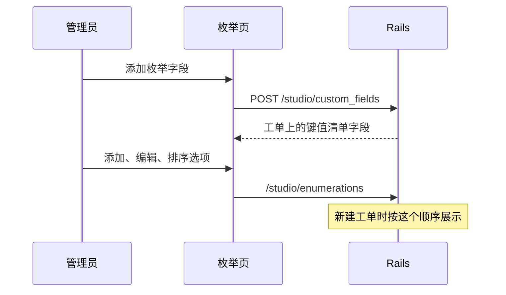

## 开发

前端说明见 [frontend/README.md](frontend/README.md)。Studio 的 JSON 接口在 `app/controllers/studio`，路由挂在 `/studio` 和 `/app`。
